# Free HTML & CSS Registration Form Templates

66 free registration, sign-up and register page templates, written in plain HTML and CSS. Open `index.html` and it works: no jQuery, no build step, no CDN calls. Each one drops into a Bootstrap 4, 5 or 6 project unchanged, or runs with no framework at all.

⭐ **If these save you time, star this repo.** It's how other developers find them.

Live previews of every template, plus more options from other designers: **[the full collection on Colorlib](https://colorlib.com/wp/free-bootstrap-registration-forms/)**.

## Contents

- [Registration forms](#registration-forms) (36)
- [Sign-up forms](#sign-up-forms) (20)
- [Registration pages](#registration-pages) (10)

## Registration forms

<table>
<tr>
<td align="center" width="33%"><a href="https://preview.colorlib.com/#colorlib-regform-1">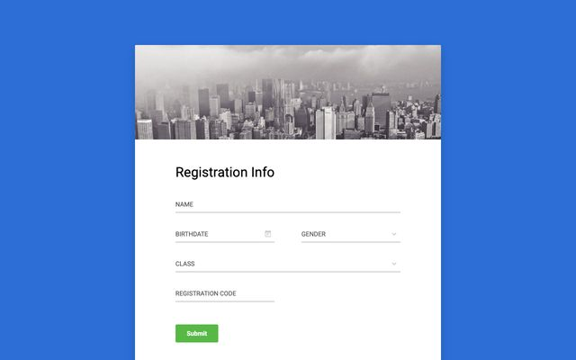</a> <b>Registration Form 1</b> <a href="https://preview.colorlib.com/#colorlib-regform-1">Demo</a> · <a href="colorlib-regform-1/">Code</a> · <a href="https://colorlib.com/wp/template/colorlib-regform-1/">Details</a></td>
<td align="center" width="33%"><a href="https://preview.colorlib.com/#colorlib-regform-2">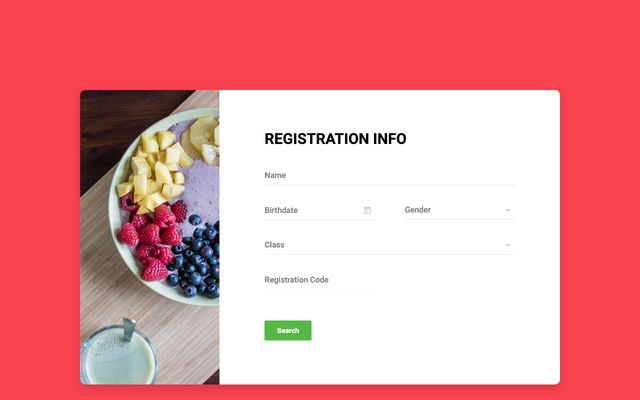</a> <b>Registration Form 2</b> <a href="https://preview.colorlib.com/#colorlib-regform-2">Demo</a> · <a href="colorlib-regform-2/">Code</a> · <a href="https://colorlib.com/wp/template/colorlib-regform-2/">Details</a></td>
<td align="center" width="33%"> <b>Registration Form 3</b> <a href="https://preview.colorlib.com/#colorlib-regform-3">Demo</a> · <a href="colorlib-regform-3/">Code</a> · <a href="https://colorlib.com/wp/template/colorlib-regform-3/">Details</a></td>
</tr>
<tr>
<td align="center" width="33%"><a href="https://preview.colorlib.com/#colorlib-regform-4">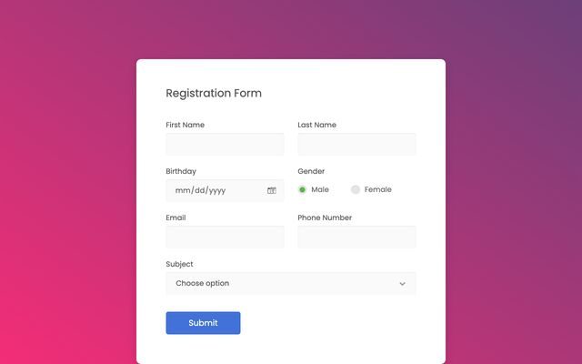</a> <b>Registration Form 4</b> <a href="https://preview.colorlib.com/#colorlib-regform-4">Demo</a> · <a href="colorlib-regform-4/">Code</a> · <a href="https://colorlib.com/wp/template/colorlib-regform-4/">Details</a></td>
<td align="center" width="33%"><a href="https://preview.colorlib.com/#colorlib-regform-5">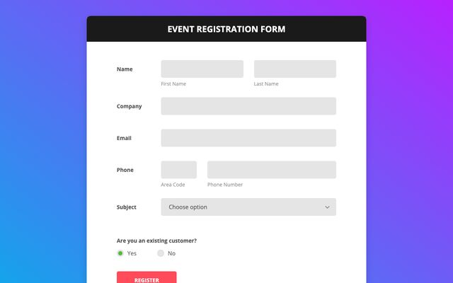</a> <b>Registration Form 5</b> <a href="https://preview.colorlib.com/#colorlib-regform-5">Demo</a> · <a href="colorlib-regform-5/">Code</a> · <a href="https://colorlib.com/wp/template/colorlib-regform-5/">Details</a></td>
<td align="center" width="33%"><a href="https://preview.colorlib.com/#colorlib-regform-6">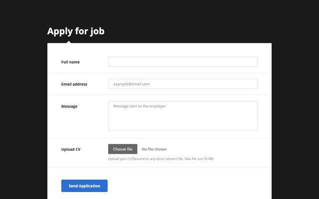</a> <b>Registration Form 6</b> <a href="https://preview.colorlib.com/#colorlib-regform-6">Demo</a> · <a href="colorlib-regform-6/">Code</a> · <a href="https://colorlib.com/wp/template/colorlib-regform-6/">Details</a></td>
</tr>
<tr>
<td align="center" width="33%"><a href="https://preview.colorlib.com/#colorlib-regform-7">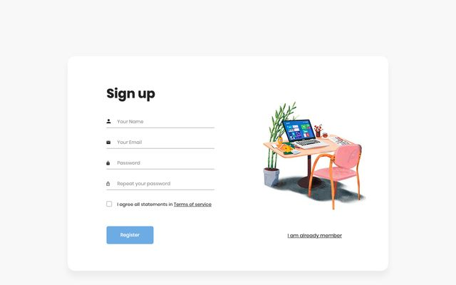</a> <b>Registration Form 7</b> <a href="https://preview.colorlib.com/#colorlib-regform-7">Demo</a> · <a href="colorlib-regform-7/">Code</a> · <a href="https://colorlib.com/wp/template/colorlib-regform-7/">Details</a></td>
<td align="center" width="33%"> <b>Registration Form 8</b> <a href="https://preview.colorlib.com/#colorlib-regform-8">Demo</a> · <a href="colorlib-regform-8/">Code</a> · <a href="https://colorlib.com/wp/template/colorlib-regform-8/">Details</a></td>
<td align="center" width="33%"> <b>Registration Form 9</b> <a href="https://preview.colorlib.com/#colorlib-regform-9">Demo</a> · <a href="colorlib-regform-9/">Code</a> · <a href="https://colorlib.com/wp/template/colorlib-regform-9/">Details</a></td>
</tr>
<tr>
<td align="center" width="33%"><a href="https://preview.colorlib.com/#colorlib-regform-10">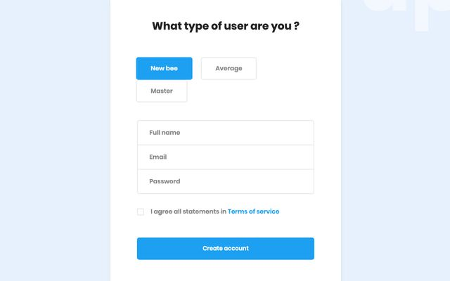</a> <b>Registration Form 10</b> <a href="https://preview.colorlib.com/#colorlib-regform-10">Demo</a> · <a href="colorlib-regform-10/">Code</a> · <a href="https://colorlib.com/wp/template/colorlib-regform-10/">Details</a></td>
<td align="center" width="33%"><a href="https://preview.colorlib.com/#colorlib-regform-11">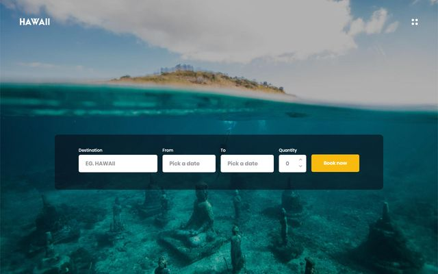</a> <b>Registration Form 11</b> <a href="https://preview.colorlib.com/#colorlib-regform-11">Demo</a> · <a href="colorlib-regform-11/">Code</a> · <a href="https://colorlib.com/wp/template/colorlib-regform-11/">Details</a></td>
<td align="center" width="33%"><a href="https://preview.colorlib.com/#colorlib-regform-12">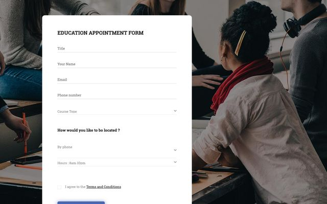</a> <b>Registration Form 12</b> <a href="https://preview.colorlib.com/#colorlib-regform-12">Demo</a> · <a href="colorlib-regform-12/">Code</a> · <a href="https://colorlib.com/wp/template/colorlib-regform-12/">Details</a></td>
</tr>
<tr>
<td align="center" width="33%"> <b>Registration Form 13</b> <a href="https://preview.colorlib.com/#colorlib-regform-13">Demo</a> · <a href="colorlib-regform-13/">Code</a> · <a href="https://colorlib.com/wp/template/colorlib-regform-13/">Details</a></td>
<td align="center" width="33%"><a href="https://preview.colorlib.com/#colorlib-regform-14">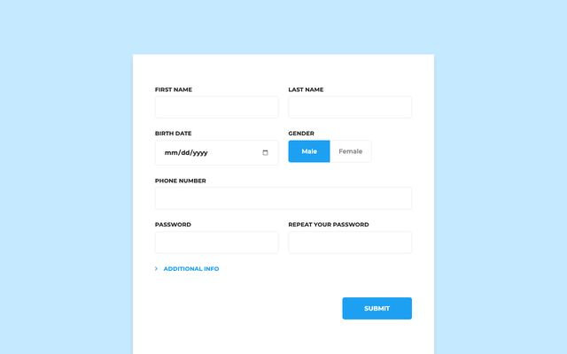</a> <b>Registration Form 14</b> <a href="https://preview.colorlib.com/#colorlib-regform-14">Demo</a> · <a href="colorlib-regform-14/">Code</a> · <a href="https://colorlib.com/wp/template/colorlib-regform-14/">Details</a></td>
<td align="center" width="33%"><a href="https://preview.colorlib.com/#colorlib-regform-15">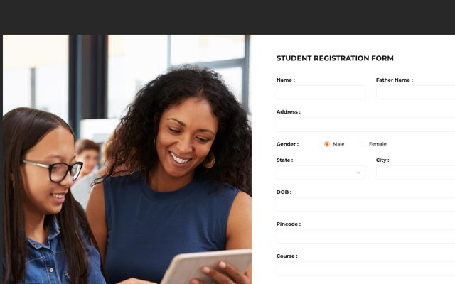</a> <b>Registration Form 15</b> <a href="https://preview.colorlib.com/#colorlib-regform-15">Demo</a> · <a href="colorlib-regform-15/">Code</a> · <a href="https://colorlib.com/wp/template/colorlib-regform-15/">Details</a></td>
</tr>
<tr>
<td align="center" width="33%"><a href="https://preview.colorlib.com/#colorlib-regform-16">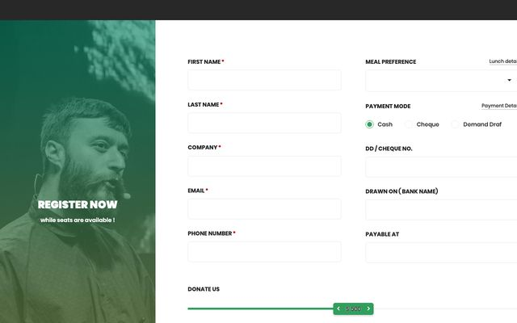</a> <b>Registration Form 16</b> <a href="https://preview.colorlib.com/#colorlib-regform-16">Demo</a> · <a href="colorlib-regform-16/">Code</a> · <a href="https://colorlib.com/wp/template/colorlib-regform-16/">Details</a></td>
<td align="center" width="33%"><a href="https://preview.colorlib.com/#colorlib-regform-17">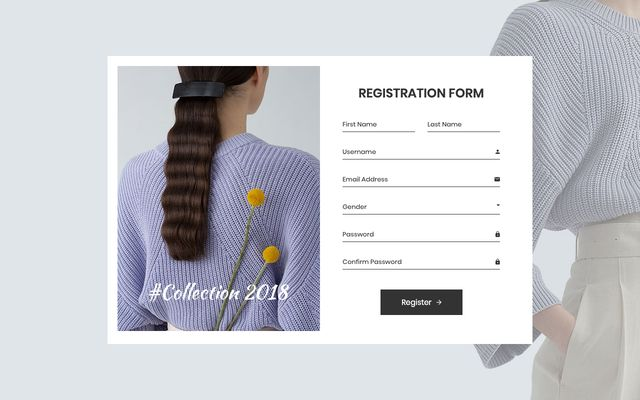</a> <b>Registration Form 17</b> <a href="https://preview.colorlib.com/#colorlib-regform-17">Demo</a> · <a href="colorlib-regform-17/">Code</a> · <a href="https://colorlib.com/wp/template/colorlib-regform-17/">Details</a></td>
<td align="center" width="33%"><a href="https://preview.colorlib.com/#colorlib-regform-18">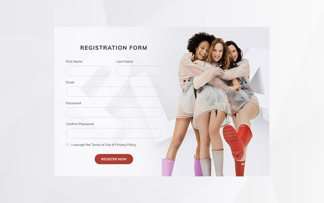</a> <b>Registration Form 18</b> <a href="https://preview.colorlib.com/#colorlib-regform-18">Demo</a> · <a href="colorlib-regform-18/">Code</a> · <a href="https://colorlib.com/wp/template/colorlib-regform-18/">Details</a></td>
</tr>
<tr>
<td align="center" width="33%"><a href="https://preview.colorlib.com/#colorlib-regform-19">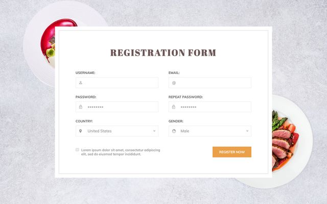</a> <b>Registration Form 19</b> <a href="https://preview.colorlib.com/#colorlib-regform-19">Demo</a> · <a href="colorlib-regform-19/">Code</a> · <a href="https://colorlib.com/wp/template/colorlib-regform-19/">Details</a></td>
<td align="center" width="33%"><a href="https://preview.colorlib.com/#colorlib-regform-20">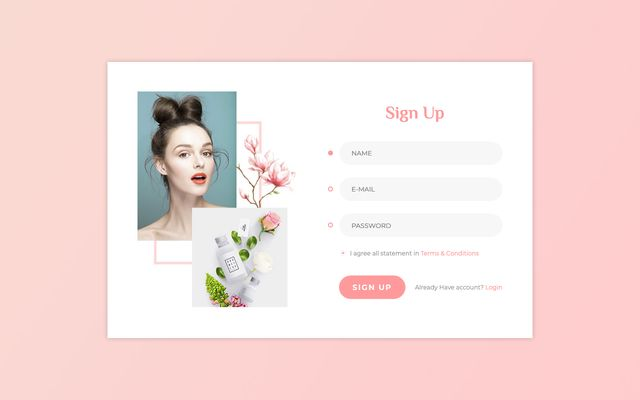</a> <b>Registration Form 20</b> <a href="https://preview.colorlib.com/#colorlib-regform-20">Demo</a> · <a href="colorlib-regform-20/">Code</a> · <a href="https://colorlib.com/wp/template/colorlib-regform-20/">Details</a></td>
<td align="center" width="33%"> <b>Registration Form 21</b> <a href="https://preview.colorlib.com/#colorlib-regform-21">Demo</a> · <a href="colorlib-regform-21/">Code</a> · <a href="https://colorlib.com/wp/template/colorlib-regform-21/">Details</a></td>
</tr>
<tr>
<td align="center" width="33%"> <b>Registration Form 22</b> <a href="https://preview.colorlib.com/#colorlib-regform-22">Demo</a> · <a href="colorlib-regform-22/">Code</a> · <a href="https://colorlib.com/wp/template/colorlib-regform-22/">Details</a></td>
<td align="center" width="33%"> <b>Registration Form 23</b> <a href="https://preview.colorlib.com/#colorlib-regform-23">Demo</a> · <a href="colorlib-regform-23/">Code</a> · <a href="https://colorlib.com/wp/template/colorlib-regform-23/">Details</a></td>
<td align="center" width="33%"> <b>Registration Form 24</b> <a href="https://preview.colorlib.com/#colorlib-regform-24">Demo</a> · <a href="colorlib-regform-24/">Code</a> · <a href="https://colorlib.com/wp/template/colorlib-regform-24/">Details</a></td>
</tr>
<tr>
<td align="center" width="33%"><a href="https://preview.colorlib.com/#colorlib-regform-25">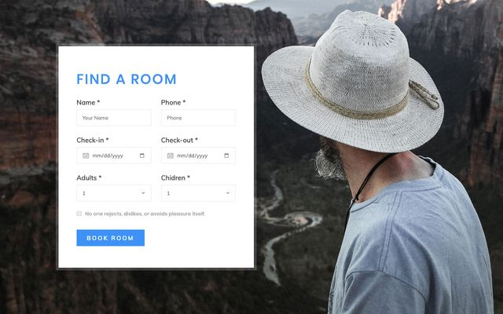</a> <b>Registration Form 25</b> <a href="https://preview.colorlib.com/#colorlib-regform-25">Demo</a> · <a href="colorlib-regform-25/">Code</a> · <a href="https://colorlib.com/wp/template/colorlib-regform-25/">Details</a></td>
<td align="center" width="33%"> <b>Registration Form 26</b> <a href="https://preview.colorlib.com/#colorlib-regform-26">Demo</a> · <a href="colorlib-regform-26/">Code</a> · <a href="https://colorlib.com/wp/template/colorlib-regform-26/">Details</a></td>
<td align="center" width="33%"><a href="https://preview.colorlib.com/#colorlib-regform-27">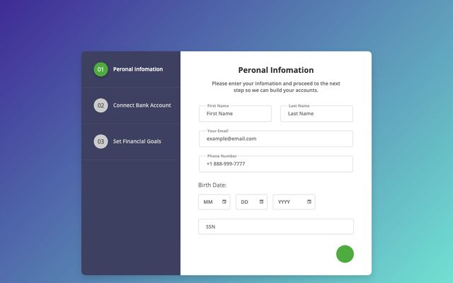</a> <b>Registration Form 27</b> <a href="https://preview.colorlib.com/#colorlib-regform-27">Demo</a> · <a href="colorlib-regform-27/">Code</a> · <a href="https://colorlib.com/wp/template/colorlib-regform-27/">Details</a></td>
</tr>
<tr>
<td align="center" width="33%"> <b>Registration Form 28</b> <a href="https://preview.colorlib.com/#colorlib-regform-28">Demo</a> · <a href="colorlib-regform-28/">Code</a> · <a href="https://colorlib.com/wp/template/colorlib-regform-28/">Details</a></td>
<td align="center" width="33%"><a href="https://preview.colorlib.com/#colorlib-regform-29">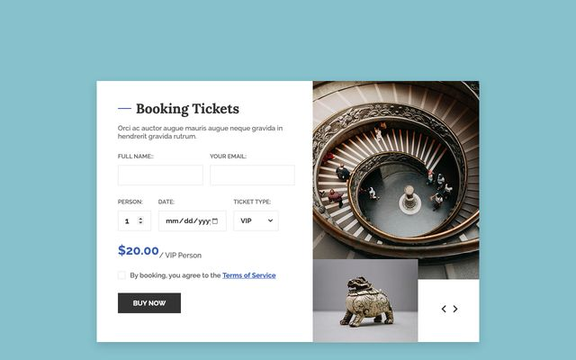</a> <b>Registration Form 29</b> <a href="https://preview.colorlib.com/#colorlib-regform-29">Demo</a> · <a href="colorlib-regform-29/">Code</a> · <a href="https://colorlib.com/wp/template/colorlib-regform-29/">Details</a></td>
<td align="center" width="33%"><a href="https://preview.colorlib.com/#colorlib-regform-30">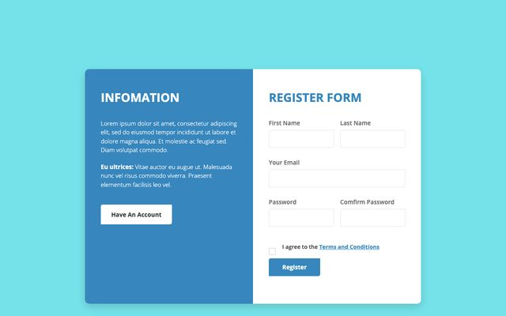</a> <b>Registration Form 30</b> <a href="https://preview.colorlib.com/#colorlib-regform-30">Demo</a> · <a href="colorlib-regform-30/">Code</a> · <a href="https://colorlib.com/wp/template/colorlib-regform-30/">Details</a></td>
</tr>
<tr>
<td align="center" width="33%"><a href="https://preview.colorlib.com/#colorlib-regform-31">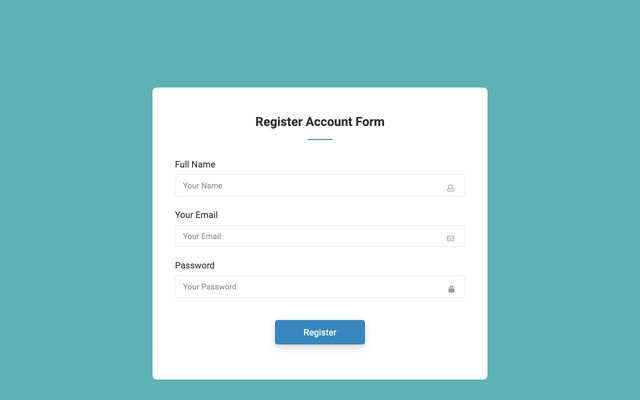</a> <b>Registration Form 31</b> <a href="https://preview.colorlib.com/#colorlib-regform-31">Demo</a> · <a href="colorlib-regform-31/">Code</a> · <a href="https://colorlib.com/wp/template/colorlib-regform-31/">Details</a></td>
<td align="center" width="33%"> <b>Registration Form 32</b> <a href="https://preview.colorlib.com/#colorlib-regform-32">Demo</a> · <a href="colorlib-regform-32/">Code</a> · <a href="https://colorlib.com/wp/template/colorlib-regform-32/">Details</a></td>
<td align="center" width="33%"> <b>Registration Form 33</b> <a href="https://preview.colorlib.com/#colorlib-regform-33">Demo</a> · <a href="colorlib-regform-33/">Code</a> · <a href="https://colorlib.com/wp/template/colorlib-regform-33/">Details</a></td>
</tr>
<tr>
<td align="center" width="33%"> <b>Registration Form 34</b> <a href="https://preview.colorlib.com/#colorlib-regform-34">Demo</a> · <a href="colorlib-regform-34/">Code</a> · <a href="https://colorlib.com/wp/template/colorlib-regform-34/">Details</a></td>
<td align="center" width="33%"> <b>Registration Form 35</b> <a href="https://preview.colorlib.com/#colorlib-regform-35">Demo</a> · <a href="colorlib-regform-35/">Code</a> · <a href="https://colorlib.com/wp/template/colorlib-regform-35/">Details</a></td>
<td align="center" width="33%"><a href="https://preview.colorlib.com/#colorlib-regform-36">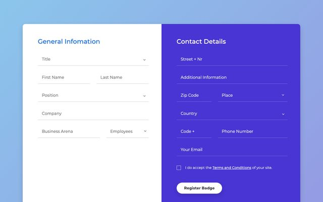</a> <b>Registration Form 36</b> <a href="https://preview.colorlib.com/#colorlib-regform-36">Demo</a> · <a href="colorlib-regform-36/">Code</a> · <a href="https://colorlib.com/wp/template/colorlib-regform-36/">Details</a></td>
</tr>
</table>

## Sign-up forms

<table>
<tr>
<td align="center" width="33%"> <b>Sign Up Form 01</b> <a href="https://preview.colorlib.com/#signup-form-01">Demo</a> · <a href="signup-form-01/">Code</a> · <a href="https://colorlib.com/wp/template/signup-form-01/">Details</a></td>
<td align="center" width="33%"><a href="https://preview.colorlib.com/#signup-form-02">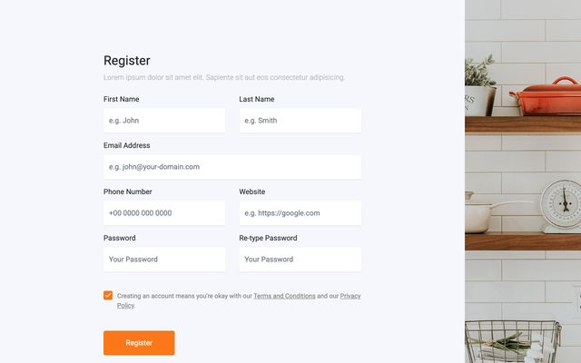</a> <b>Sign Up Form 02</b> <a href="https://preview.colorlib.com/#signup-form-02">Demo</a> · <a href="signup-form-02/">Code</a> · <a href="https://colorlib.com/wp/template/signup-form-02/">Details</a></td>
<td align="center" width="33%"><a href="https://preview.colorlib.com/#signup-form-03">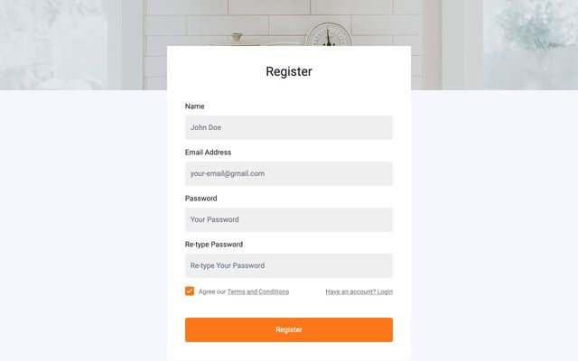</a> <b>Sign Up Form 03</b> <a href="https://preview.colorlib.com/#signup-form-03">Demo</a> · <a href="signup-form-03/">Code</a> · <a href="https://colorlib.com/wp/template/signup-form-03/">Details</a></td>
</tr>
<tr>
<td align="center" width="33%"><a href="https://preview.colorlib.com/#signup-form-04">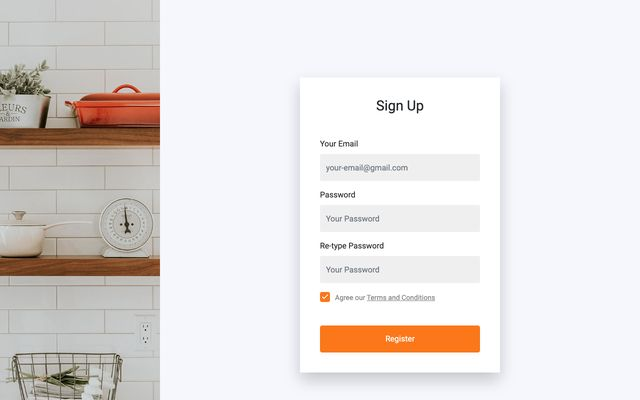</a> <b>Sign Up Form 04</b> <a href="https://preview.colorlib.com/#signup-form-04">Demo</a> · <a href="signup-form-04/">Code</a> · <a href="https://colorlib.com/wp/template/signup-form-04/">Details</a></td>
<td align="center" width="33%"><a href="https://preview.colorlib.com/#signup-form-05">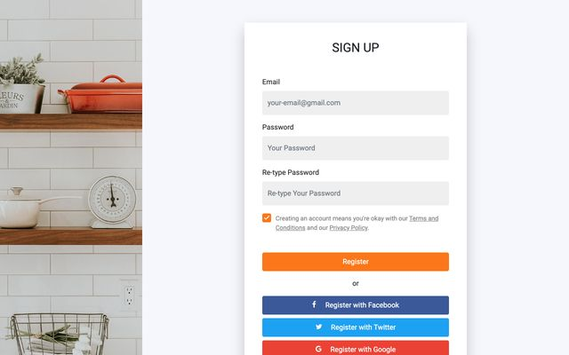</a> <b>Sign Up Form 05</b> <a href="https://preview.colorlib.com/#signup-form-05">Demo</a> · <a href="signup-form-05/">Code</a> · <a href="https://colorlib.com/wp/template/signup-form-05/">Details</a></td>
<td align="center" width="33%"> <b>Sign Up Form 06</b> <a href="https://preview.colorlib.com/#signup-form-06">Demo</a> · <a href="signup-form-06/">Code</a> · <a href="https://colorlib.com/wp/template/signup-form-06/">Details</a></td>
</tr>
<tr>
<td align="center" width="33%"><a href="https://preview.colorlib.com/#signup-form-07">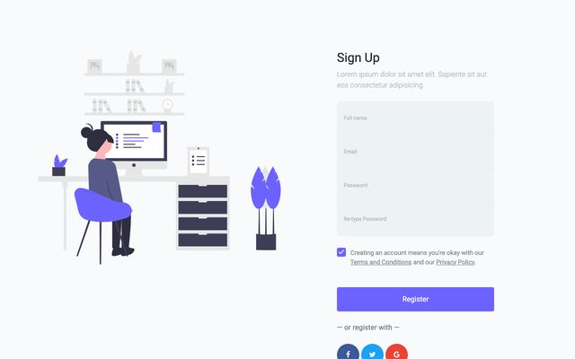</a> <b>Sign Up Form 07</b> <a href="https://preview.colorlib.com/#signup-form-07">Demo</a> · <a href="signup-form-07/">Code</a> · <a href="https://colorlib.com/wp/template/signup-form-07/">Details</a></td>
<td align="center" width="33%"> <b>Sign Up Form 08</b> <a href="https://preview.colorlib.com/#signup-form-08">Demo</a> · <a href="signup-form-08/">Code</a> · <a href="https://colorlib.com/wp/template/signup-form-08/">Details</a></td>
<td align="center" width="33%"><a href="https://preview.colorlib.com/#signup-form-09">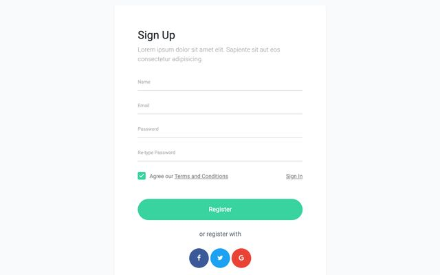</a> <b>Sign Up Form 09</b> <a href="https://preview.colorlib.com/#signup-form-09">Demo</a> · <a href="signup-form-09/">Code</a> · <a href="https://colorlib.com/wp/template/signup-form-09/">Details</a></td>
</tr>
<tr>
<td align="center" width="33%"><a href="https://preview.colorlib.com/#signup-form-10">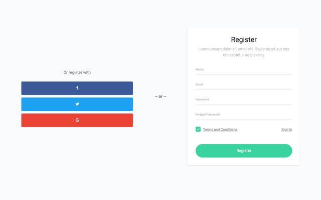</a> <b>Sign Up Form 10</b> <a href="https://preview.colorlib.com/#signup-form-10">Demo</a> · <a href="signup-form-10/">Code</a> · <a href="https://colorlib.com/wp/template/signup-form-10/">Details</a></td>
<td align="center" width="33%"><a href="https://preview.colorlib.com/#signup-form-11">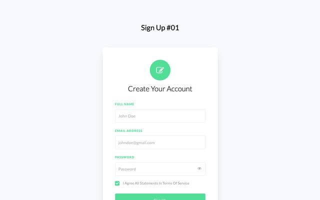</a> <b>Sign Up Form 11</b> <a href="https://preview.colorlib.com/#signup-form-11">Demo</a> · <a href="signup-form-11/">Code</a> · <a href="https://colorlib.com/wp/template/signup-form-11/">Details</a></td>
<td align="center" width="33%"><a href="https://preview.colorlib.com/#signup-form-12">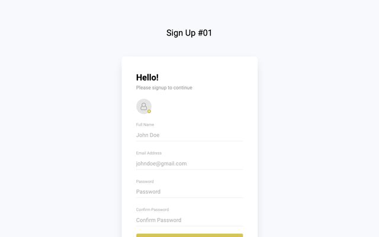</a> <b>Sign Up Form 12</b> <a href="https://preview.colorlib.com/#signup-form-12">Demo</a> · <a href="signup-form-12/">Code</a> · <a href="https://colorlib.com/wp/template/signup-form-12/">Details</a></td>
</tr>
<tr>
<td align="center" width="33%"><a href="https://preview.colorlib.com/#signup-form-13">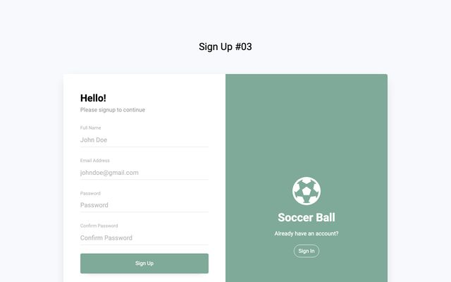</a> <b>Sign Up Form 13</b> <a href="https://preview.colorlib.com/#signup-form-13">Demo</a> · <a href="signup-form-13/">Code</a> · <a href="https://colorlib.com/wp/template/signup-form-13/">Details</a></td>
<td align="center" width="33%"><a href="https://preview.colorlib.com/#signup-form-14">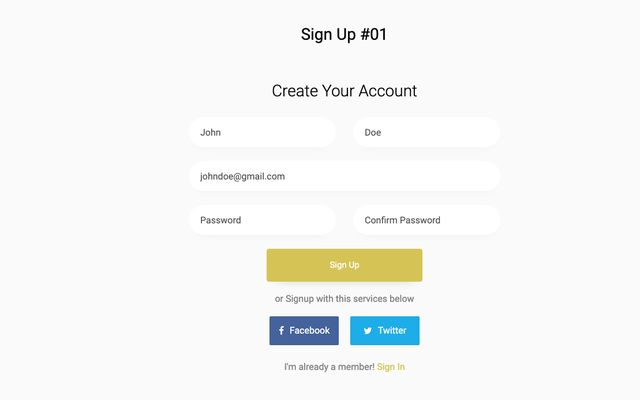</a> <b>Sign Up Form 14</b> <a href="https://preview.colorlib.com/#signup-form-14">Demo</a> · <a href="signup-form-14/">Code</a> · <a href="https://colorlib.com/wp/template/signup-form-14/">Details</a></td>
<td align="center" width="33%"><a href="https://preview.colorlib.com/#signup-form-15">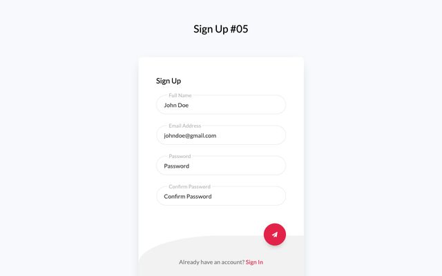</a> <b>Sign Up Form 15</b> <a href="https://preview.colorlib.com/#signup-form-15">Demo</a> · <a href="signup-form-15/">Code</a> · <a href="https://colorlib.com/wp/template/signup-form-15/">Details</a></td>
</tr>
<tr>
<td align="center" width="33%"><a href="https://preview.colorlib.com/#signup-form-16">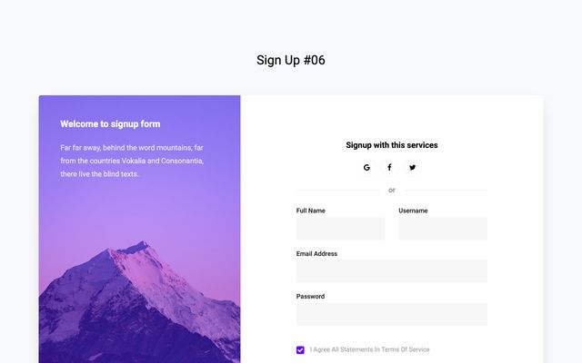</a> <b>Sign Up Form 16</b> <a href="https://preview.colorlib.com/#signup-form-16">Demo</a> · <a href="signup-form-16/">Code</a> · <a href="https://colorlib.com/wp/template/signup-form-16/">Details</a></td>
<td align="center" width="33%"> <b>Sign Up Form 17</b> <a href="https://preview.colorlib.com/#signup-form-17">Demo</a> · <a href="signup-form-17/">Code</a> · <a href="https://colorlib.com/wp/template/signup-form-17/">Details</a></td>
<td align="center" width="33%"><a href="https://preview.colorlib.com/#signup-form-18">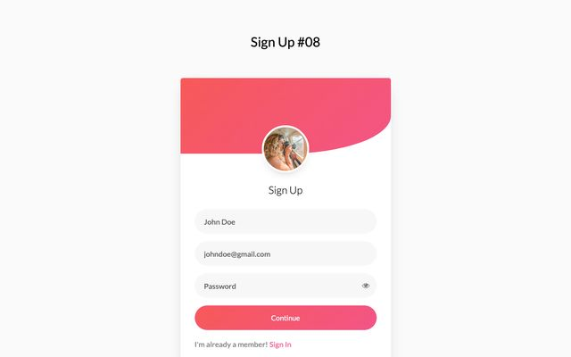</a> <b>Sign Up Form 18</b> <a href="https://preview.colorlib.com/#signup-form-18">Demo</a> · <a href="signup-form-18/">Code</a> · <a href="https://colorlib.com/wp/template/signup-form-18/">Details</a></td>
</tr>
<tr>
<td align="center" width="33%"> <b>Sign Up Form 19</b> <a href="https://preview.colorlib.com/#signup-form-19">Demo</a> · <a href="signup-form-19/">Code</a> · <a href="https://colorlib.com/wp/template/signup-form-19/">Details</a></td>
<td align="center" width="33%"><a href="https://preview.colorlib.com/#signup-form-20">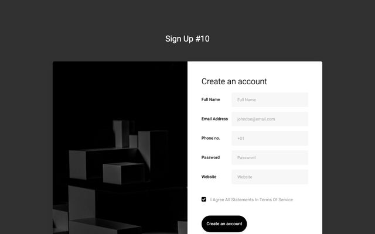</a> <b>Sign Up Form 20</b> <a href="https://preview.colorlib.com/#signup-form-20">Demo</a> · <a href="signup-form-20/">Code</a> · <a href="https://colorlib.com/wp/template/signup-form-20/">Details</a></td>
</tr>
</table>

## Registration pages

<table>
<tr>
<td align="center" width="33%"><a href="https://preview.colorlib.com/#registration-page-01">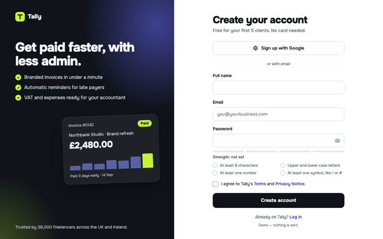</a> <b>Registration Page 01</b> <a href="https://preview.colorlib.com/#registration-page-01">Demo</a> · <a href="registration-page-01/">Code</a> · <a href="https://colorlib.com/wp/template/registration-page-01/">Details</a></td>
<td align="center" width="33%"><a href="https://preview.colorlib.com/#registration-page-02">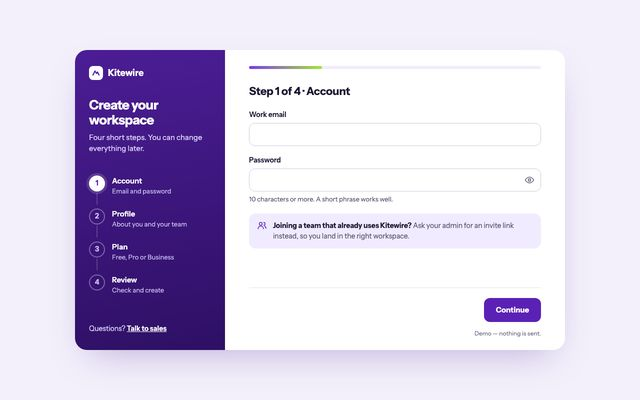</a> <b>Registration Page 02</b> <a href="https://preview.colorlib.com/#registration-page-02">Demo</a> · <a href="registration-page-02/">Code</a> · <a href="https://colorlib.com/wp/template/registration-page-02/">Details</a></td>
<td align="center" width="33%"><a href="https://preview.colorlib.com/#registration-page-03">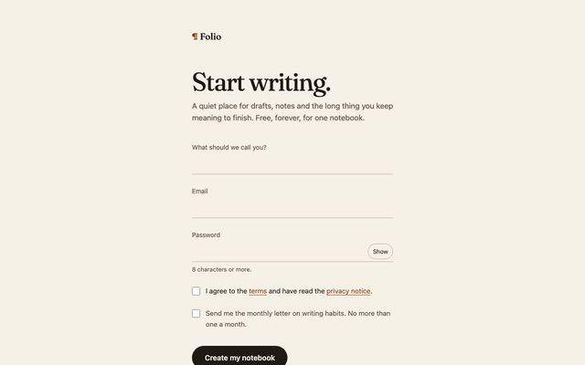</a> <b>Registration Page 03</b> <a href="https://preview.colorlib.com/#registration-page-03">Demo</a> · <a href="registration-page-03/">Code</a> · <a href="https://colorlib.com/wp/template/registration-page-03/">Details</a></td>
</tr>
<tr>
<td align="center" width="33%"> <b>Registration Page 04</b> <a href="https://preview.colorlib.com/#registration-page-04">Demo</a> · <a href="registration-page-04/">Code</a> · <a href="https://colorlib.com/wp/template/registration-page-04/">Details</a></td>
<td align="center" width="33%"><a href="https://preview.colorlib.com/#registration-page-05">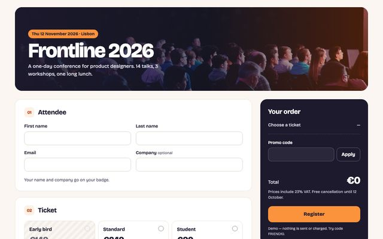</a> <b>Registration Page 05</b> <a href="https://preview.colorlib.com/#registration-page-05">Demo</a> · <a href="registration-page-05/">Code</a> · <a href="https://colorlib.com/wp/template/registration-page-05/">Details</a></td>
<td align="center" width="33%"><a href="https://preview.colorlib.com/#registration-page-06">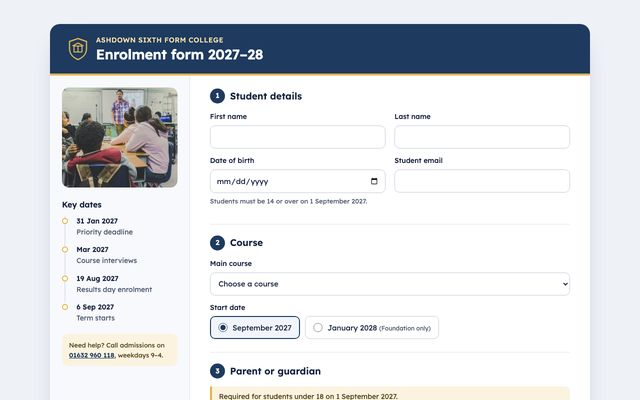</a> <b>Registration Page 06</b> <a href="https://preview.colorlib.com/#registration-page-06">Demo</a> · <a href="registration-page-06/">Code</a> · <a href="https://colorlib.com/wp/template/registration-page-06/">Details</a></td>
</tr>
<tr>
<td align="center" width="33%"><a href="https://preview.colorlib.com/#registration-page-07">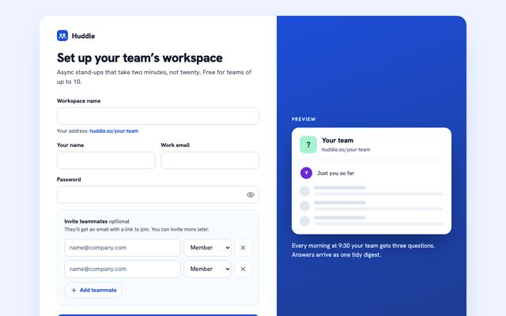</a> <b>Registration Page 07</b> <a href="https://preview.colorlib.com/#registration-page-07">Demo</a> · <a href="registration-page-07/">Code</a> · <a href="https://colorlib.com/wp/template/registration-page-07/">Details</a></td>
<td align="center" width="33%"><a href="https://preview.colorlib.com/#registration-page-08">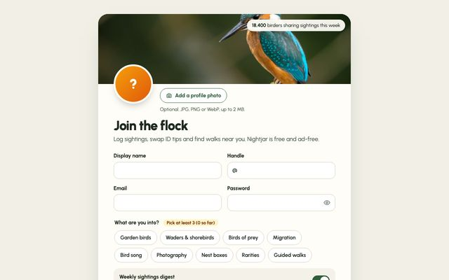</a> <b>Registration Page 08</b> <a href="https://preview.colorlib.com/#registration-page-08">Demo</a> · <a href="registration-page-08/">Code</a> · <a href="https://colorlib.com/wp/template/registration-page-08/">Details</a></td>
<td align="center" width="33%"><a href="https://preview.colorlib.com/#registration-page-09">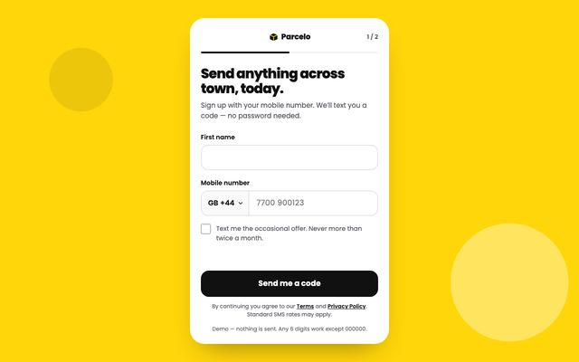</a> <b>Registration Page 09</b> <a href="https://preview.colorlib.com/#registration-page-09">Demo</a> · <a href="registration-page-09/">Code</a> · <a href="https://colorlib.com/wp/template/registration-page-09/">Details</a></td>
</tr>
<tr>
<td align="center" width="33%"><a href="https://preview.colorlib.com/#registration-page-10">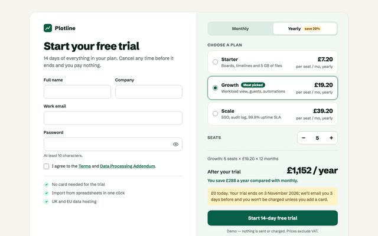</a> <b>Registration Page 10</b> <a href="https://preview.colorlib.com/#registration-page-10">Demo</a> · <a href="registration-page-10/">Code</a> · <a href="https://colorlib.com/wp/template/registration-page-10/">Details</a></td>
</tr>
</table>

## How to use one

1. Clone the repo, or download it as a ZIP from the green **Code** button.
2. Copy the folder of the template you want into your project.
3. Open its `index.html` in a browser. Every folder is self-contained: `css/style.css`, a small `js/snippet.js` where the template needs behaviour, plus its own fonts and images.

Using Bootstrap already? Load the template's `css/style.css` after your framework stylesheet. Class names are namespaced per template, so they won't collide with yours.

## License

Free for personal and commercial use, including client work. Attribution is appreciated but not required. Photography, where present, is licensed for use inside these templates. See [LICENSE.md](LICENSE.md).

## More free templates from Colorlib

- [Free HTML & CSS Login Form Templates](https://github.com/ColorlibHQ/login-form-templates)
- [Free Coming Soon & Under Construction Page Templates](https://github.com/ColorlibHQ/coming-soon-page-templates)
- [Free HTML & CSS Contact Form Templates](https://github.com/ColorlibHQ/contact-form-templates)
- [Free 404 & Error Page Templates](https://github.com/ColorlibHQ/404-error-page-templates)
- [Free Multi-Step Form & Form Wizard Templates](https://github.com/ColorlibHQ/multi-step-form-templates)
- [Free Booking & Appointment Form Templates](https://github.com/ColorlibHQ/booking-form-templates)
- [Free HTML & CSS Search Form Templates](https://github.com/ColorlibHQ/search-form-templates)
- [Free Navigation Menu, Sidebar & Dropdown Templates](https://github.com/ColorlibHQ/navigation-menu-templates)
- [Free HTML & CSS Table Templates](https://github.com/ColorlibHQ/html-table-templates)
- [Free HTML Form Templates: Job Application, Survey & Newsletter](https://github.com/ColorlibHQ/html-form-templates)
- [Free HTML & CSS UI Components](https://github.com/ColorlibHQ/html-css-ui-components)

Building an admin panel or a web app?

- [Gentelella](https://github.com/ColorlibHQ/gentelella) and [Adminator](https://github.com/puikinsh/Adminator-admin-dashboard): free admin dashboard templates
- [DashboardPack](https://dashboardpack.com/templates/?utm_source=github&utm_medium=readme&utm_campaign=registration-form-templates): premium dashboards for React, Vue, Angular, Next.js, Laravel and plain HTML

Made by [Colorlib](https://colorlib.com/).
